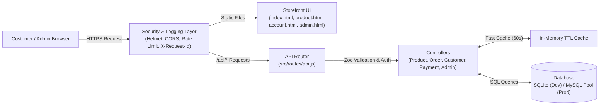
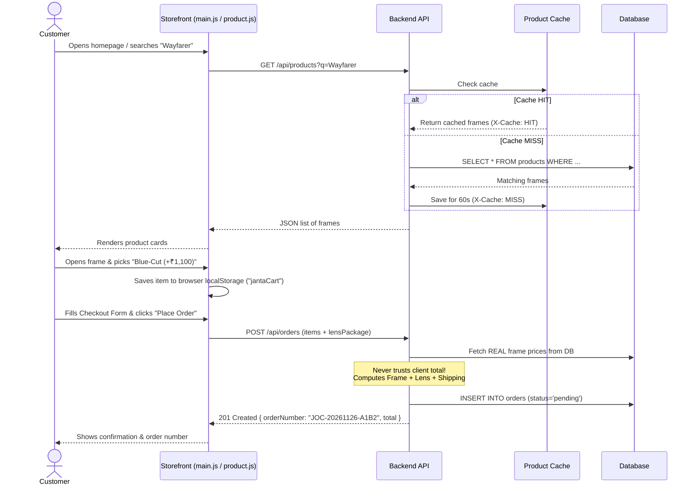
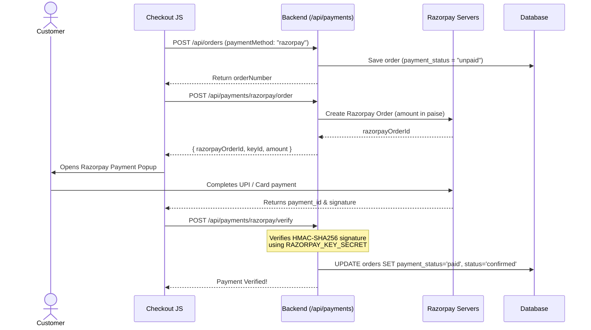
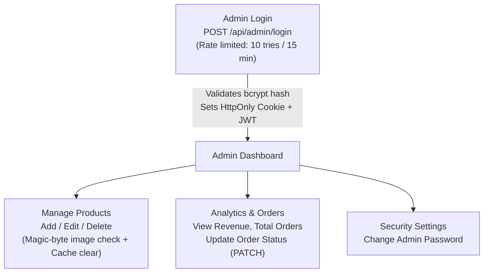

# Janta Optical Centre — Complete Website Workflow & Architecture Guide

Welcome! Think of this guide as a walkthrough of how a modern, enterprise-grade e-commerce website works from the moment a customer types your website address into their browser all the way to storing an order in the database, taking payment, and printing a GST invoice.

---

## 1. The Big Picture (How Everything Connects)

Imagine your website is like a **real optical showroom**:
1. **The Storefront (`public/`)** is the glass display, trial mirror, and billing counter that customers see.
2. **The Security Guard (`src/middleware/`)** checks IDs, stops troublemakers (rate limiting), and inspects packages (validation & image checks) before anyone enters the back office.
3. **The Receptionist (`src/routes/api.js`)** listens to what the visitor wants (browse frames, place an order, track an order, login as admin) and sends them to the right department.
4. **The Managers (`src/controllers/`)** do the actual business logic (calculating prices, checking stock, verifying payments).
5. **The Filing Cabinet (`src/db/`)** is the database (SQLite locally, MySQL in production) where products, orders, customers, prescriptions, and admins are safely stored.

---

## 2. How the Server Starts Up (`server.js` → `src/app.js`)

When you run `npm start` or `node server.js`:

1. **`src/config/env.js`** loads your `.env` settings (`PORT`, `JWT_SECRET`, `DB_HOST`, `RAZORPAY_KEY_ID`, etc.).
   - *Safety rule:* In production (`NODE_ENV=production`), if `JWT_SECRET` is missing, the server refuses to start so no one can hack admin tokens.
2. **`src/db/index.js`** connects to **MySQL** (using a connection pool of 10 connections) if `DB_HOST` is set, or **SQLite** (`data/products.db` in WAL mode) locally.
3. **`src/db/migrations.js`** runs automatically on startup and ensures all tables (`products`, `orders`, `admins`, `customers`, `prescriptions`) and columns exist.
4. **`src/app.js`** wires up security headers (`helmet`), compression (`gzip`), JSON body parsing, structured logging, dynamic `/sitemap-products.xml`, `/healthz`, static files (`public/`), and `/api` routes.

---

## 3. Customer Shopping & Checkout Workflow

Here is the step-by-step journey of a customer buying glasses:

### Why Server-Side Price Calculation Matters
A clever attacker could open browser DevTools and try to send `total: 1` for a ₹4,000 frame. Because `orderController.js` ignores any price from the browser, looks up the real frame price in the database, adds the official lens package fee (`0`, `600`, `1100`, or `2400`), and adds shipping (`FREE` if `>= ₹999`, else `₹79`), the price can **never** be tampered with.

---

## 4. Online Payment Workflow (Razorpay)

If the customer selects **Pay Online (Razorpay / Cards / UPI)** at checkout:

---

## 5. Customer Account & Prescriptions Workflow (`account.html`)

Customers can create an account to save their eye power (`SPH`, `CYL`, `AXIS`, `PD`) for future orders and view their past orders:
- **Register / Login:** `POST /api/customers/register` and `POST /api/customers/login` hash passwords with `bcryptjs` (cost 12) and issue an `HttpOnly` cookie (`joc_customer_token`) so JavaScript cannot steal the session token.
- **Prescriptions:** `GET / POST / DELETE /api/customers/prescriptions` lets customers store multiple prescriptions (e.g., *Everyday*, *Reading*).
- **Order History:** `GET /api/customers/orders` shows all orders linked to that customer.

---

## 6. Order Tracking & GST Invoice Workflow (`invoice.html`)

1. A customer clicks **Track Order** in the navbar or footer.
2. They enter their **Order Number** (e.g. `JOC-20261126-A1B2`) and **Phone Number**.
3. `GET /api/orders/track` verifies that the last 10 digits of the phone number match the order (so strangers cannot snoop on other people's orders).
4. Inside the tracking result, clicking **View / Print Tax Invoice** opens `invoice.html`, which calls `GET /api/orders/:orderNumber/invoice?phone=...` and displays a printable invoice with **12% GST** split into **6% CGST** and **6% SGST**.

---

## 7. Admin Panel Workflow (`admin.html`)

Only authorized store staff can manage inventory and orders:

- **Image Upload Protection:** When an admin uploads product photos, `multer` limits them to 4 files (max 2 MB each), and `verifyUploadedImages` reads the **actual binary header (magic bytes)** of each file to ensure it is truly a JPEG, PNG, or WebP image.
- **Cache Invalidation:** Whenever a product is created, edited, or deleted, `productCache.clear()` runs immediately so customers see the updated catalog right away.

---

## 8. File Map (Where Everything Lives)

| Folder / File | Purpose |
| :--- | :--- |
| [server.js](file:///Users/satishpradhan/JantaOpticalCenter/server.js) | Entry point: runs DB migrations, starts HTTP server, handles graceful shutdown |
| [src/app.js](file:///Users/satishpradhan/JantaOpticalCenter/src/app.js) | Configures Express middleware, `/healthz`, dynamic `/sitemap-products.xml`, static files |
| [src/config/env.js](file:///Users/satishpradhan/JantaOpticalCenter/src/config/env.js) | Loads and validates environment variables |
| [src/db/index.js](file:///Users/satishpradhan/JantaOpticalCenter/src/db/index.js) | Unified async DB helper (SQLite locally, MySQL pool in production) |
| [src/db/migrations.js](file:///Users/satishpradhan/JantaOpticalCenter/src/db/migrations.js) | Creates/evolves tables safely on startup |
| [src/middleware/](file:///Users/satishpradhan/JantaOpticalCenter/src/middleware) | Security (`helmet`, `cors`, rate limits), auth, Zod validation, image upload checks, logging |
| [src/controllers/](file:///Users/satishpradhan/JantaOpticalCenter/src/controllers) | Business logic for `products`, `orders`, `customers`, `payments`, and `admin` |
| [src/routes/api.js](file:///Users/satishpradhan/JantaOpticalCenter/src/routes/api.js) | All `/api/*` endpoint definitions |
| [public/index.html](file:///Users/satishpradhan/JantaOpticalCenter/public/index.html) | Main storefront (Hero, Shape filter, Search/Filter bar, Cart, Checkout, Order Tracker) |
| [public/product.html](file:///Users/satishpradhan/JantaOpticalCenter/public/product.html) | Dedicated Product Detail Page with Lens Configurator |
| [public/account.html](file:///Users/satishpradhan/JantaOpticalCenter/public/account.html) | Customer login, saved prescriptions, and order history |
| [public/invoice.html](file:///Users/satishpradhan/JantaOpticalCenter/public/invoice.html) | Printable GST Tax Invoice |
| [public/admin.html](file:///Users/satishpradhan/JantaOpticalCenter/public/admin.html) | Admin Dashboard (Products, Analytics, Order Status, Password Settings) |
| [tests/api.test.js](file:///Users/satishpradhan/JantaOpticalCenter/tests/api.test.js) | Automated integration tests (`npm test`) |
